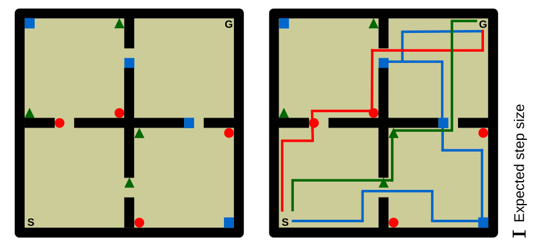
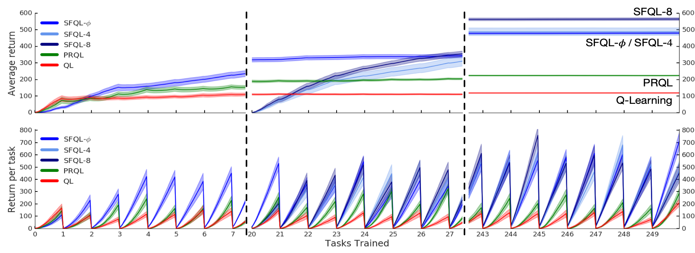
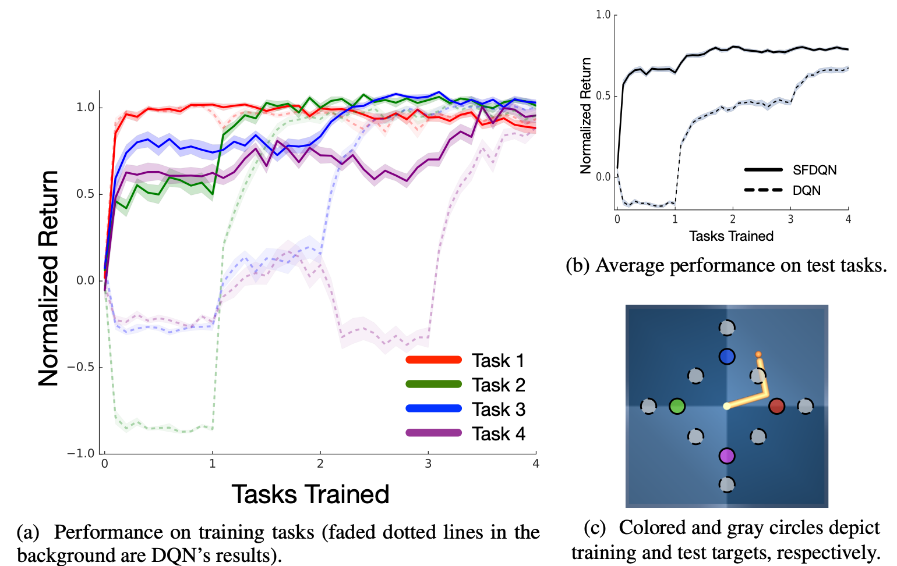

# **Successor Features for Transfer** 
## in Reinforcement Learning
   

**Decoupling Dynamics from Rewards for Zero-Shot Generalization**

*Based on the paper by André Barreto et al. (DeepMind)*
*Presented by: [Vidush Jindal]*

---

## The Motivation: Why Transfer RL?

Standard RL agents excel at isolated tasks but struggle to adapt when goals change.

- **Standard RL:** Learn Task A $\rightarrow$ Forget $\rightarrow$ Learn Task B (from scratch).
- **Transfer RL:** Learn Task A $\rightarrow$ Extract Knowledge $\rightarrow$ Solve Task B (instantly).

**Real-world analogy:** 
Driving a car. The physics (*dynamics*) of the car never change, but your destination (*reward*) changes daily. An agent shouldn't have to relearn how to steer just because the destination changed!

---

## The Linear Reward Assumption

We model tasks as a set of MDPs sharing the same state space $\mathcal{S}$, action space $\mathcal{A}$, and transition dynamics $p$. 

We assume the one-step reward can be decoupled linearly:

$$ r(s, a, s') = \boldsymbol{\phi}(s, a, s')^\top \mathbf{w} $$

- $\boldsymbol{\phi} \in \mathbb{R}^d$: Features of the environment (*The constant physics/dynamics*).
- $\mathbf{w} \in \mathbb{R}^d$: Task-specific weights (*The agent's shifting goal*).

*By making this assumption, we mathematically isolate when reward changes from what stays the same (MDP of environment)*

---

## Deriving Successor Features (SFs)

Let's rewrite the standard Action-Value function $Q^\pi(s,a)$ by substituting our new reward equation:

$$Q^\pi(s, a) = \mathbb{E}^\pi \left[ \sum_{i=t}^{\infty} \gamma^{i-t} r_{i+1} \mid S_t=s, A_t=a \right]$$

Substitute $r_{i+1}$ with $\boldsymbol{\phi}_{i}^\top \mathbf{w}$ and pull out the weights $\mathbf{w}$:

$$ Q^\pi(s, a) = \mathbb{E}^\pi \left[ \sum_{i=t}^{\infty} \gamma^{i-t} \boldsymbol{\phi}_{i} \right]^\top \mathbf{w} $$

$$ Q^\pi(s, a) = \boldsymbol{\psi}^\pi(s, a)^\top \mathbf{w} $$

Here, $\boldsymbol{\psi}^\pi(s,a)$ is the **Successor Feature**—the expected discounted sum of future environment features.

---

## Generalized Policy Improvement (GPI)

What if we have historical data from *multiple* past policies $\pi_1, \pi_2, \dots, \pi_n$? 

We can define a new policy $\pi$ that acts greedily with respect to the **maximum** of all available value functions:

$$ \pi(s) \in \arg\max_a \max_i \tilde{Q}^{\pi_i}(s, a) $$

**Theorem 1 (GPI Bound):** 
The new policy will perform no worse than *any* of the historical policies, minus a small approximation penalty (the reward structure of underlying policies is same):

$$ Q^\pi(s, a) \ge \max_i Q^{\pi_i}(s, a) - \frac{2}{1 - \gamma}\epsilon $$

---

## Putting it Together: The Transfer Mechanics

1. **Build a Library:** Learn and store SFs $\boldsymbol{\psi}^{\pi_i}$ for various tasks.
2. **Observe New Task:** When a new task arrives, estimate its reward weights $\mathbf{w}_{new}$ (a simple supervised learning problem).
3. **Zero-Shot Evaluation:** Instantly compute the value of all old policies on the new task using a simple dot product: 
   
   $$ Q_{new}^{\pi_i}(s,a) = \boldsymbol{\psi}^{\pi_i}(s,a)^\top \mathbf{w}_{new} $$

4. **Apply GPI:** Execute the best action using $\arg\max_a \max_i Q_{new}^{\pi_i}(s,a)$.

---

## Theorem 2: Theoretical Guarantees

How good is this zero-shot transfer? (the reward structure changes, so we first compute new state action values zero shot then use theorem 1)

If we use GPI over $n$ previously learned optimal policies, the loss of our zero-shot policy compared to the *true optimal policy* $Q_i^*$ is strictly bounded:

$$ Q_i^*(s, a) - Q_i^\pi(s, a) \le \frac{2}{1 - \gamma} \left( \phi_{\max} \min_j ||\mathbf{w}_i - \mathbf{w}_j|| + \epsilon \right) $$

**Key Insight:** 
The algorithm's performance is bound by how geometrically close the new task ($\mathbf{w}_i$) is to the closest previously solved task ($\mathbf{w}_j$) in the feature space.

---

## Empirical Results: 4-Room Gridworld (SFQL)

- The algorithm outperforms standard Q-Learning and Probabilistic Policy Reuse.
- It works beautifully even when features $\boldsymbol{\phi}$ are *learned* from data rather than hard-coded.

<small>Figure 1 (Barreto et al.): layout and optimal trajectories for three tasks. Shapes are object classes, 'S' the start, 'G' the goal.</small>

---

## Empirical Results: 4-Room Gridworld returns

<small>Figure 2 (Barreto et al.): average and per-task return over 250 tasks. SFQL-h gets no reward in the first 20 tasks while it learns its features. Bands: one standard error over 30 runs.</small>

---

## Empirical Results: Reacher (SFDQN)

- The math scales to Deep RL using Neural Networks.
- The agent reaches near-optimal performance on previously unseen target coordinates instantaneously.

<small>Figure 3 (Barreto et al.): normalized return; 1 = DQN trained on each task separately, 0 = random agent.</small>

---

## Summary

- **Modularity:** Successor Features seamlessly decouple the physics of the world from the agent's current objective (rewards).
- **Synergy:** SFs combined with Generalized Policy Improvement (GPI) allow for instantaneous, zero-shot transfer learning.
- **Rigorous:** Grounded in solid mathematical bounds.
- **Scalable:** Readily integrates with deep neural networks for complex continuous control.

   
**Thank You**
